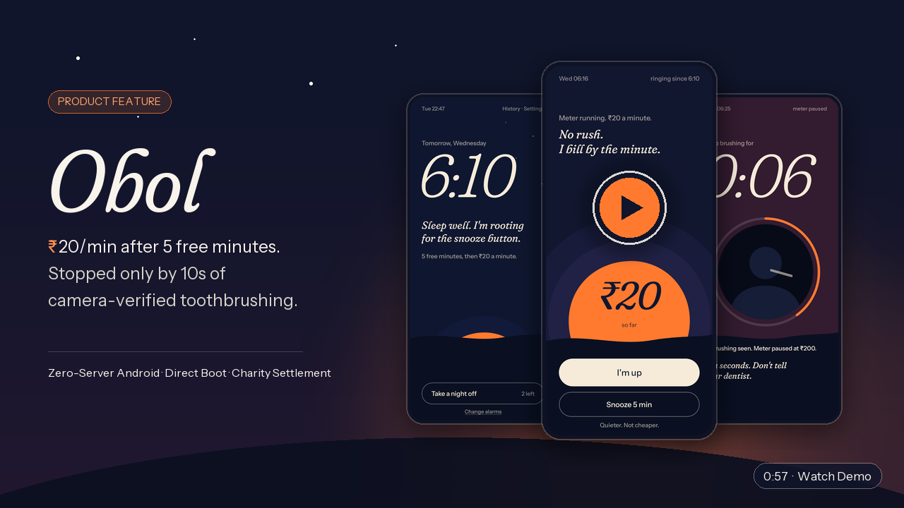
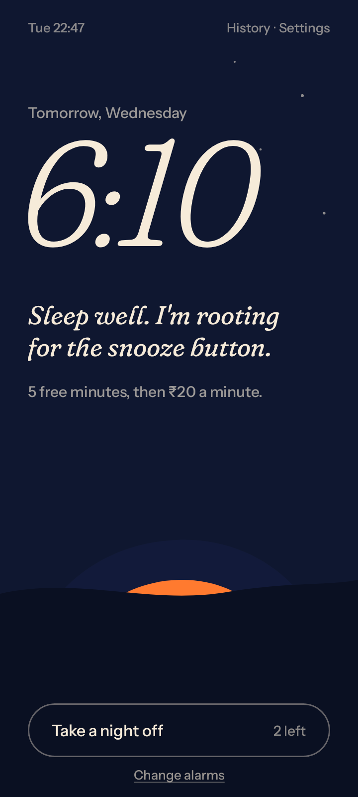
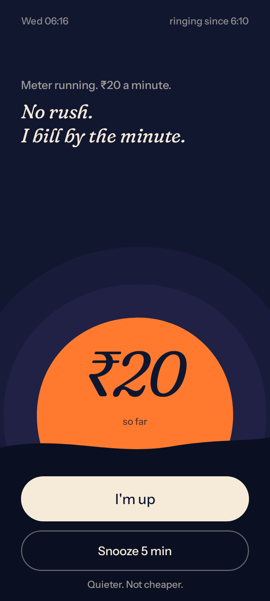
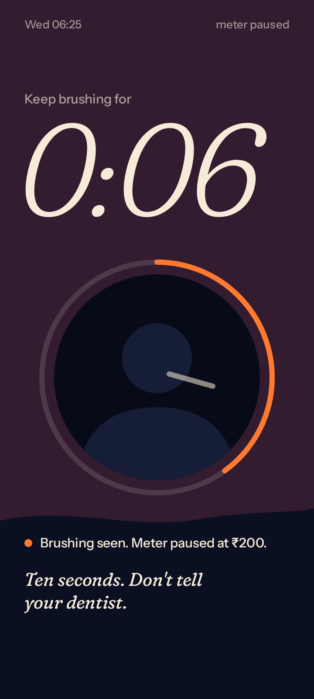
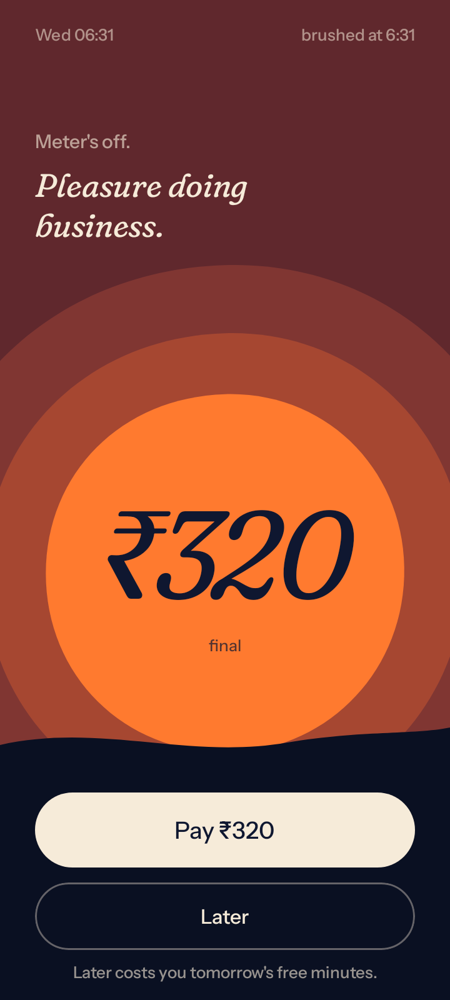
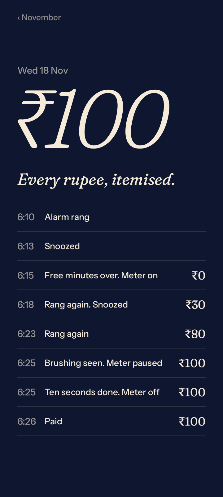
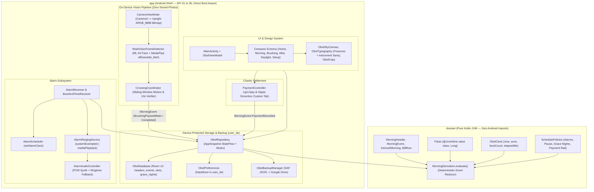
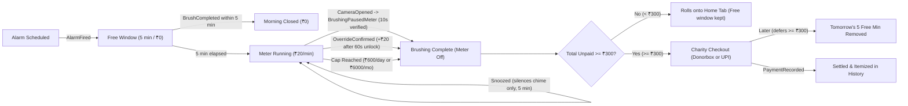

# Obol

> *"Sleep well. I'm rooting for the snooze button."*

**Obol** (`dev.prayush.obol`) is a personal, zero-server native Android commitment alarm clock built with Kotlin and Jetpack Compose. It gives you **5 free minutes** when your alarm rings, then runs a continuous live meter at **₹20/minute** (₹1 every 3 seconds). Snoozing silences the chime for 5 minutes — **it does not stop the meter**. The meter only stops when the front camera verifies **10 seconds of brushing your teeth** on-device, and accumulated charges are donated to charity via **Oppia Donorbox** or **Indian UPI**.

<p>
  &nbsp;
  &nbsp;
  &nbsp;
  &nbsp;
  &nbsp;
  
</p>

---

## Product Demo Video

<p align="center">
  <a href="https://iamprayush.github.io/obol/docs/demo/">
    
  </a>
  <br />
  <sub><a href="https://iamprayush.github.io/obol/docs/demo/"><strong>▶ Play Demo Video (0:57)</strong></a> · <a href="https://iamprayush.github.io/obol/Obol%20-%20Product%20Feature.mp4">Direct MP4 Stream</a></sub>
</p>

The product walkthrough video demonstrates the complete morning loop on device:
1. **Alarm & Free Window** — full-screen alarm over lock screen with a 5-minute grace window.
2. **Live Sunrise Meter** — sky heats from ink navy to apricot as charges climb at ₹20/minute (snooze quiets audio only).
3. **On-Device Brushing Proof** — CameraX + ML Kit Face + MediaPipe `efficientdet_lite0` verify 10 seconds of toothbrushing near the mouth with motion, pausing the meter immediately.
4. **Itemized Bill & Charity Checkout** — deterministic event-sourced breakdown settled via Oppia Donorbox or Indian UPI.

---

## Screen Showcase

| Home (Night Before) | Live Sunrise Meter (`₹20/min`) | On-Device Brushing (`10s`) | Charity Checkout | Itemized Event Bill |
| :---: | :---: | :---: | :---: | :---: |
|  |  |  |  |  |

---

## How Obol Works

### The Morning Loop
1. **Alarm fires** on your primary phone (works across overnight reboots via Android Direct Boot).
2. **5 free minutes (`300s`)** — getting up and starting brushing within 5 minutes costs **₹0**.
3. **Meter starts at ₹20/minute** — charges accrue continuously (₹1 every 3 seconds). Tapping **Snooze 5 min** silences the alarm chime, *not* the meter.
4. **10 seconds of verified brushing** — the front camera verifies a face, a toothbrush near the mouth, and brushing motion (`BRUSH_TARGET_MS = 10_000L`). A 60-second fallback unlock lets you type a confirmation sentence for a **₹20 override fee** if lighting or hardware fails.
5. **Running tab & charity settlement** — balances under **₹300** roll onto the Home tab without stripping tomorrow's free window; once unpaid debt reaches **₹300+**, Obol prompts donation via **Oppia Donorbox** (Chrome Custom Tab) or **Indian UPI** (`upi://pay`).

### Two Overriding Product Rules
1. **The honest morning is free.** Getting up within 5 minutes costs ₹0.
2. **No charge the app cannot justify.** Every rupee is derived deterministically from an append-only, timestamped event log and displayed in an itemized bill. If Android prevents an alarm from firing, the morning cancels for ₹0.

### Core Mechanics & Policies

| Mechanic | Behavior |
| :--- | :--- |
| **Free Window** | `5 minutes` (`300s`) from alarm fire (removed for 1 day if a payable `≥ ₹300` balance is deferred). |
| **Meter Rate** | `₹20 / minute` (`₹1` every `3s`). |
| **Caps** | `₹600` per morning · `₹6,000` per calendar month (snapshotted per morning in Room v2). |
| **Wake Proof** | `10s` camera-verified brushing (`BRUSH_DROPOUT_GRACE_MS = 10s`), or `60s`-unlocked typed sentence (`₹20` override fee). |
| **Charity Threshold** | `₹300` minimum tab (`MIN_DONATION_THRESHOLD_PAISE`); sub-₹300 balances combine across mornings until payable. |
| **Payment Rails** | **Oppia Foundation (Donorbox)** via Chrome Custom Tab or **Indian UPI** (`upi://pay`); destination edits lock for 24h once set. |
| **Grace Nights** | `3 nights off / month`, declarable `≥ 2h` before alarm, refundable anytime before the alarm fires. |
| **Alarm Audio** | 3 synthesized PCM chimes (`Marimba`, `Singing bowl`, `Electric piano`) + Android `RingtoneManager` with Direct Boot PCM fallback. |
| **Cloud Backup** | Single-file JSON (`obol-backup.json`) via Android Storage Access Framework (Google Drive) — zero GCP OAuth, zero `INTERNET` permission. |

---

## Architecture

Obol is split into two Gradle modules with strict boundaries: a pure Kotlin JVM **`:domain`** core with zero Android dependencies, and an **`:app`** Android shell.

### System & Module Architecture



### Event-Sourced Morning State Machine



---

## Engineering Highlights & Invariants

- **Integer-only currency (`Paise`):** All money arithmetic uses `@JvmInline value class Paise(val value: Long)` — never `Float` or `Double`.
- **Anti-tamper piecewise monotonic clock (`ObolClock`):** Within the same `bootCount`, elapsed time is measured via monotonic `elapsedMs` (`SystemClock.elapsedRealtime()`), defeating manual wall-clock rewind; across device reboots, timelines bridge cleanly via wall-clock `Instant`.
- **Event-sourced Room v2 ledger:** Every state, charge, sky heat fraction, and itemized bill row is deterministically replayed from `morning_events` (`MorningDerivation.evaluate`). Room `MIGRATION_1_2` snapshots `ratePaisePerMin`, `morningCapPaise`, and `monthlyCapPaise` per morning so historical bills never shift when rates change.
- **Android 15 (`targetSdk = 35`) & Direct Boot (`directBootAware="true"`):**
  - Both Room (`obol.db`) and DataStore (`obol_prefs.preferences_pb`) reside in Device-Protected storage (`user_de`) so alarms fire and record events even after an overnight reboot before unlock.
  - `BootAndTimeReceiver` works around Android 15's restriction on starting `mediaPlayback` foreground services from boot broadcasts by scheduling an immediate `setAlarmClock` boot recovery trigger (`REASON_ALARM_MANAGER`) into `AlarmRingingService` (`systemExempted|mediaPlayback`).
  - ML Kit initializes cleanly under Direct Boot via an application-scoped `ContextWrapper` around `dpContext`.
- **Single upright vision coordinate space:** `CameraViewfinder` converts `ImageProxy` once into a rotated upright `ARGB_8888` `Bitmap` so ML Kit Face Detection (mouth/nose landmarks + luma) and MediaPipe Object Detection (`efficientdet_lite0.tflite`, `toothbrush` class) evaluate the exact same frame geometry. Frames are processed in memory and closed immediately — **zero photos are ever stored**.
- **Zero `INTERNET` permission:** `AndroidManifest.xml` intentionally omits `android.permission.INTERNET`. Donorbox opens in Chrome Custom Tabs, and Google Drive backup writes `obol-backup.json` via Android's Storage Access Framework (`"rwt"` file descriptor mode + immediate read-back validation + deferred flush on unlock).

---

## Project Structure

```text
obol/
├── Obol - Product Feature.mp4                  # Product walkthrough video
├── PROJECT_CONTEXT.md                          # Deep engineering handoff & Android 15/SAF notes
├── build.gradle.kts / settings.gradle.kts
├── gradle/libs.versions.toml                   # Centralized dependency catalog
├── domain/                                     # Pure Kotlin JVM module (zero Android imports)
│   └── src/
│       ├── main/kotlin/dev/prayush/obol/domain/
│       │   ├── engine/MorningDerivation.kt     # Deterministic event-log reducer
│       │   ├── model/                          # Paise, ObolConstants, MorningModels
│       │   ├── policy/SchedulePolicies.kt      # Alarm, pause, grace night & rail policies
│       │   └── time/ObolClock.kt               # Piecewise monotonic clock math
│       └── test/kotlin/dev/prayush/obol/domain/# JUnit 5 domain test suite
├── app/                                        # Native Android module (Compose, Room, CameraX)
│   ├── roborazzi/                              # 25+ golden screenshot regression PNGs
│   ├── schemas/                                # Exported Room v1 & v2 SQLite schemas
│   └── src/
│       ├── main/
│       │   ├── AndroidManifest.xml             # Direct Boot components, zero INTERNET perm
│       │   ├── assets/efficientdet_lite0.tflite# MediaPipe toothbrush detector
│       │   └── kotlin/dev/prayush/obol/
│       │       ├── alarm/                      # AlarmScheduler, Service, PCM synth audio
│       │       ├── data/                       # Room v2, DE DataStore, Repository, SAF Backup
│       │       ├── design/                     # Sky canvas, Fraunces/Instrument Sans typography
│       │       ├── di/AppContainer.kt          # Manual DI container
│       │       ├── payment/PaymentController.kt# UPI & Oppia Donorbox Custom Tab
│       │       ├── ui/                         # ViewModel, copy mapper, Compose screens
│       │       └── vision/                     # CameraX, ML Kit + MediaPipe, CrossingCoordinator
│       ├── debug/ & release/                   # Debug simulation drawer (stripped in release)
│       └── test/                               # Robolectric, Roborazzi, migration & repository tests
└── docs/design/                                # Early design specs & HTML screen prototypes
```

---

## Build, Test & Install

### Prerequisites
- **JDK 21** (or JDK 17; `jvmTarget = "17"`)
- **Android SDK 35** (`platforms;android-35`, `build-tools;35.0.0`, `platform-tools`)
- **Gradle 8.11.1** (via `./gradlew`)
- A local `local.properties` file at the repository root:
  ```properties
  sdk.dir=/path/to/your/android-sdk
  ```

### Verification Commands

```bash
# 1. Pure-Kotlin domain tests (money arithmetic, event replay, schedule policies)
./gradlew :domain:test

# 2. Record / update Roborazzi golden screenshots
./gradlew :app:recordRoborazziDebug

# 3. Full suite: domain tests + debug & release unit tests + lint + release APK
./gradlew :domain:test check assembleRelease

# 4. Install release APK onto a connected device
adb install -r app/build/outputs/apk/release/app-release.apk
```

> For detailed product decision rationale, typography/italic-clipping fixes, Google Drive SAF overwrite details, and APK signing/upgrade instructions, see [`PROJECT_CONTEXT.md`](./PROJECT_CONTEXT.md).
