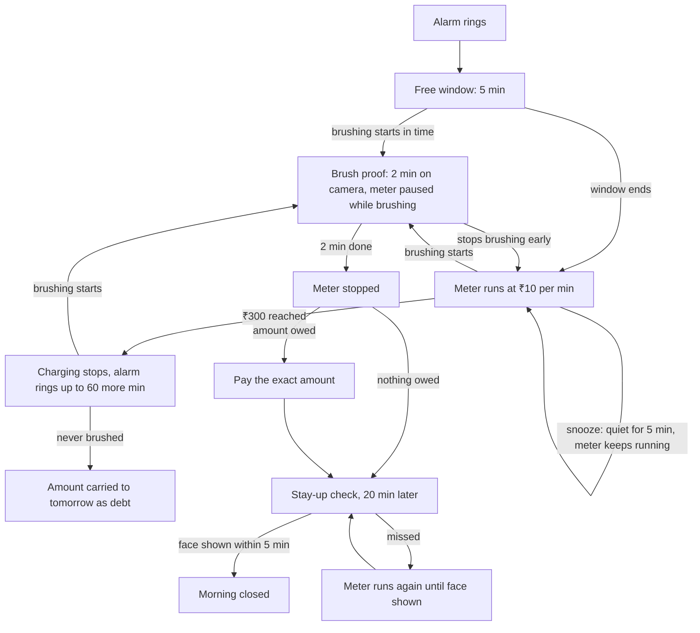

# Obol — user flow

Obol charges money for every minute you stay in bed after the alarm. The charging ends only when the camera has watched you brush your teeth for two minutes. It runs on your main phone.

## Definitions

```
free window   = 5 min after the alarm (0 min if a toll is unpaid)
rate          = ₹10 per min, fixed
meter running = free window over AND brush proof not complete AND not brushing right now
toll          = rate × minutes the meter ran,
                up to ₹300 per morning and ₹3,000 per calendar month
```

- **Brush proof:** two minutes in total of the camera seeing a live face with a toothbrush moving at the mouth, in a lit room.
- **Stay-up check:** 20 minutes after the brush proof, the phone rings and you show your face to the camera in a lit room.
- **Debt:** a toll that has not been paid. It carries to the next morning and removes that morning's free window.

The numbers (5 min, ₹10, 2 min, 20 min, 60 min) are starting values.

## The morning at a glance



## Setup (once)

1. Grant the alarm, camera and notification permissions and the battery exemption.
2. Set an alarm time for each day of the week.
3. Run the first week with charging off. Everything else behaves as normal.

## The night before

The bedtime screen shows three things: tomorrow's alarm time, anything unpaid, and the grace-night button.

- **Grace night:** three per calendar month, declared the night before. The alarm still rings; nothing is charged.
- **Alarm changes:** making an alarm later or switching it off takes effect after 24 hours. For tomorrow, use a grace night. Making it earlier applies at once.
- **Pause (sick or travel):** starts 12 hours after you switch it on and lasts until you switch it off.

## The morning

1. **Alarm rings.** The free window counts down. Start brushing inside it and the morning costs nothing.
2. **Meter starts.** The screen leads with the amount taken so far.
3. **Snooze.** It silences the alarm for five minutes and does nothing to the meter. Each re-ring is louder and shows the amount first.
4. **Brush proof.** Open the camera at the sink and brush.
   - The meter pauses while brushing is seen.
   - It resumes if brushing is not seen for 10 seconds; progress is kept.
   - After two minutes in total, the meter stops for good.
5. **Pay.** If anything is owed, one tap opens the payment with the exact amount filled in. A free morning skips this step.
6. **Stay-up check.** The phone rings 20 minutes later; it can be done early, from 10 minutes.
   - Show your face within 5 minutes and the morning closes.
   - Miss it and the meter runs again until you do. The extra is added to the toll, and one more check follows 20 minutes later.

## When things go wrong

- **You never brush.** Charging stops at ₹300. The alarm rings for 60 more minutes, then stops. The amount becomes debt.
- **You do not pay.** The amount becomes debt.
- **The camera cannot verify for 60 seconds.** An override opens: type a long sentence shown on screen and accept a ₹20 fee. The stay-up check still follows.
- **The phone is switched off or the app is killed after the alarm fired.** The morning is not cancelled. The meter is worked out from the clock as if it had kept running, and the ring resumes when the app is back.
- **The alarm never fired.** The morning is cancelled and nothing is charged.

## Worked example

Alarm at 6:10. The free window ends at 6:15.

| Time | What happens | Meter |
|---|---|---|
| 6:13 | Snooze | ₹0 |
| 6:18 | Re-ring, snooze again | ₹30 |
| 6:23 | Re-ring, get up | ₹80 |
| 6:25 | Brushing seen, meter pauses | ₹100 |
| 6:27 | Two minutes done, meter stops, pay ₹100 | ₹100 |
| 6:47 | Stay-up check passed, morning closed | ₹100 |

A clean morning: brushing by 6:14, done at 6:16, nothing to pay, stay-up check at 6:36.

## Not in this flow

The changing rate, the weekly cap, the monthly pardon, the sleep-anxiety guard, the history lock during debt, the pay-later threshold, the quarterly eject, and face enrolment.

## Still to settle

1. **Sink sticker.** Tapping or scanning a sticker on the bathroom mirror to start the brush proof would prove you left the bed. Without it, a toothbrush and lamp by the bed still pass.
2. **Payment rail.** One ₹10 test on each rail on the main phone, then keep one.
3. **Two-minute detection.** Whether the camera keeps seeing the toothbrush through real brushing has not been measured.
4. **Alarm reliability on the main phone.** The overnight test ran on the Motorola; if the main phone differs, it needs repeating.
